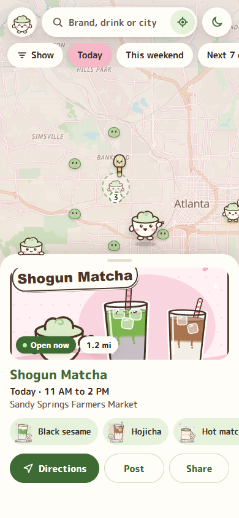

# Matcha Map: design and motion

## Round 2 direction (rung N7)

1. **The map is the app.** On a phone the map runs edge to edge; the chrome floats over it as three soft pieces: Mattie's disc (About), one search pill (zip, city or brand, with Near me inside it) and the theme disc.
2. **One chip row**, white pills with a shadow, scrolling sideways: Show first, then the dates. Today is the pink one.
3. **The list is a sheet, not a page.** It peeks from the bottom with a count ("12 pop-ups in view"); drag or tap it up. A tapped pin opens the card sheet in its place.
4. **Card: verdict first.** The picture (photo or drink scene) carries the verdict badges (Open now, distance); then the name, one line of when, one line of where, drink chips with their art, and one green Directions button. Everything else is below the fold.
5. **One product.** Radii 26 (sheets), 18 (cards, pictures), pill (chips, buttons); two shadows (resting, floating); type 13, 15, 17, 21, 26; tap targets 44 px or more. Dark mode uses the same shapes on night greens.
6. **Motion has three moments**: the opening (map settles, pins drop in a wave from the centre, Mattie hops in), the pin that grows into the card, and the flight to a place with a short petal trail. Everything else is a quiet fade or slide; reduced motion keeps only fades.

---

# The cinematic pass (rung 32)

## What "cinematic" means here

A pop-up map is not a film, but it can borrow four things from one.

- **Scene.** Every view has one subject. The map is the set, the pins are the cast, the card is the close-up. When a card opens, the map steps back; when it closes, the map comes forward again.
- **Light.** Real places have a time of day. The page and the map take a faint tint from the visitor's clock: a peach morning, a clear day, a warm evening, a cool night. It never fights the pastel map; you feel it more than you see it.
- **Timing.** Things arrive a little slower than they leave. Entrances take a third of a second and slow down as they land; exits are quicker. When many things arrive, they come in a short ripple from the middle out, never a long parade. Nothing makes you wait: any tap skips the opening, and with reduced motion on, the site is the same site without the movement.
- **Character.** Mattie is the one actor allowed to overact: the only bounce on the page is his. Everything else glides. Mattie notices you (a glance or a wave when you point at a pin), points at the card he belongs to, naps when there is nothing on, and Chasen whisks while the data loads.

## The ideas

Each idea has the feeling it should give and what it costs. **Built tonight** are marked ✅; the rest are a backlog for you to pick from.

### Arrival and opening

1. ✅ **The pour.** First visit: Mattie rises in holding a little pitcher, pours, and the map opens up from where the matcha lands, while the camera eases in a touch and the pins ripple out from the middle. Under 1.2 seconds, any tap or key skips it. *Feeling:* the map is being made for you. *Cost:* one new pose, a reworked opening timeline, no new libraries.
2. ✅ **Pins arrive from the centre out.** Pins rise into place in a short ripple, nearest the middle first, eight steps at most. *Feeling:* a stage filling up, not a page loading. *Cost:* small; the existing marker sync with a delay per ring.
3. **Your region first** (backlog). On a phone, open on the visitor's remembered zip or the busiest region instead of the whole country, which is small on a tall screen. *Feeling:* "this is about me." *Cost:* small, needs a decision on what to show a first-time visitor without asking for location.

### The map as a stage

4. ✅ **Time-of-day light.** Morning, day, evening and night tints on the page wash and the map, from the visitor's clock. At evening and night, open pop-ups get a faint lantern glow underneath. *Feeling:* the map is alive at the hour you are looking. *Cost:* one overlay and four colour sets; no effect on speed.
5. ✅ **Pins that notice you.** Point at or tab to a pin and that Mattie glances and waves once. The selected pin lifts off the map, its shadow shrinks, and Mattie points up at his card. *Feeling:* the cast is paying attention. *Cost:* small; one new pose.
6. ✅ **Breathing clusters and a slow ring.** A dango cluster takes one breath when its count changes; the "place not posted yet" ring pulses very slowly, so it reads as "around here", never "right here". *Feeling:* calm, honest life. *Cost:* tiny.
7. ✅ **Happening now.** A pop-up that is open right now has a wisp of steam rising from its cup (and says "happening now" to screen readers). *Feeling:* go now. *Cost:* small.
8. ✅ **Filters cross-fade with a petal drift.** Today, This weekend and Next 7 days fade the old pins out and the new ones in, with a few petals drifting across the map. *Feeling:* a scene change, not a refresh. *Cost:* small.
9. ✅ **City jump.** Typing a zip or city glides the camera there (never longer than two seconds) and the list slides in from the side as it lands. *Feeling:* travel. *Cost:* small.
10. **Clusters that open like a flower** (backlog). Zooming into a cluster sends its pins out from the cluster's spot instead of popping in place. *Feeling:* you can follow where things went. *Cost:* medium; needs care on slow phones.

### The card as a scene

11. ✅ **Card choreography.** Opening a card lifts it, the photo settles a few pixels, then the name, time, place, menu, brand row and latest posts come in one after another. Closing is quicker and simpler. *Feeling:* a close-up. *Cost:* small, all in the new motion files.
12. ✅ **The photo as a sticker.** The post photo sits in a cream frame with a strip of washi tape, like the Instagram flyers; it fades in when it has loaded and drifts slightly slower than the text when you scroll the sheet. A photo that fails becomes the drawn card. *Feeling:* the site and the flyers are one brand. *Cost:* small.
13. **Share a pop-up** (backlog). A Share button on the card that opens the phone's share sheet with the pop-up's own link. *Feeling:* bring a friend. *Cost:* small; needs the deep-link owner's okay.

### The phone

14. ✅ **A real bottom sheet.** The card opens half way, with the map and the pin still visible above it; drag it up for everything, down to close. The handle is a button too, so it works by keyboard. *Feeling:* native, in your thumb's reach. *Cost:* medium; one new script.
15. **Date chips at the bottom** (backlog). On phones, move Today / This weekend / Next 7 days to a bar at the bottom where the thumb is. *Feeling:* one-handed. *Cost:* medium; changes the header layout.

### Delight and character

16. ✅ **Empty state.** When nothing is on, sleepy Mattie, one line, and one button to the next range (Today goes to This weekend, the weekend to the next 7 days). On a phone it floats over the map too. *Feeling:* a shrug and a way forward. *Cost:* small.
17. ✅ **Loading.** Chasen whisks while the data loads, and the list shows soft placeholder rows instead of a blank. *Feeling:* something is being made. *Cost:* small.
18. ✅ **Calmer type.** One display weight, data (dates, times, counts, distances, prices) in M PLUS 1 Code, the monospaced sibling of the house font, softer shadows and an even rhythm in rows and cards. *Feeling:* more expensive, easier to read. *Cost:* CSS only.
19. **Mattie watches your pick** (backlog). The Mattie in the header turns to look toward the selected pin. *Feeling:* company. *Cost:* small.
20. **Weekend tour** (backlog). A play button that flies from pop-up to pop-up for the weekend in your city, a few seconds each. *Feeling:* a trailer for your Saturday. *Cost:* medium.

## Rules the build follows

- Only transform and opacity move. No layout is animated. Long lists are left alone.
- Entrances 240 to 420 ms, exits faster, ripples of 20 to 40 ms per step capped at eight steps, easing that slows down as it lands. The one bounce belongs to Mattie.
- Reduced motion (the system setting, or `?motion=reduce`) turns every movement off; the site works the same.
- Everything new lives in `site/motion.css` and `site/motion.js`; `app.js` only announces what happened (card opened, filter changed, city reached).
- Test switches: `?intro=1` replays the opening, `?tod=morning|day|evening|night` forces the light.
