# QA: cards (2026-11-22)

Rendered with headless Chrome over CDP (true 390x844 and 1440x900 device metrics, theme via the `matchamap.theme` localStorage key), scale 0.5. File names: `<route>-<width>-<light|dark>.png` (cards-demo images run 400-450 KB because the page is tall; the rest are under 200 KB).

| route | 390 light | 390 dark | 1440 light | 1440 dark | findings | fixed in |
|---|---|---|---|---|---|---|
| /e/3547255523a6/ (photo, all day) | 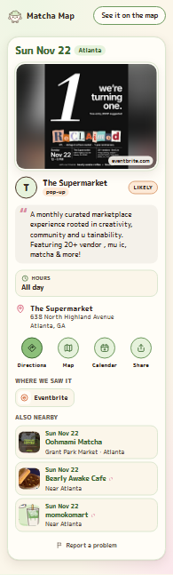 | 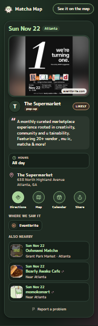 | 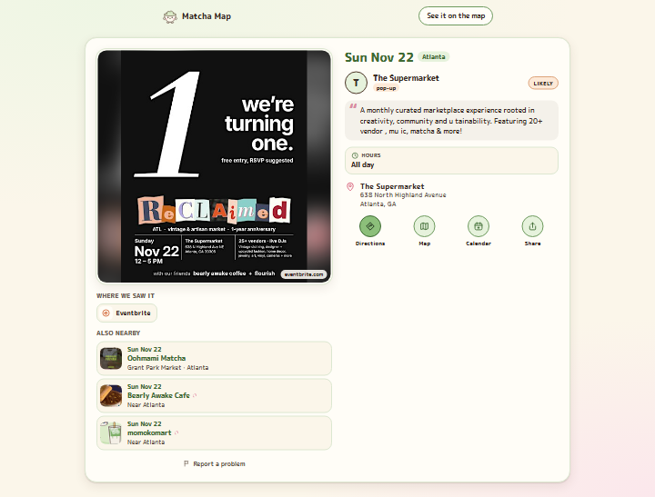 | 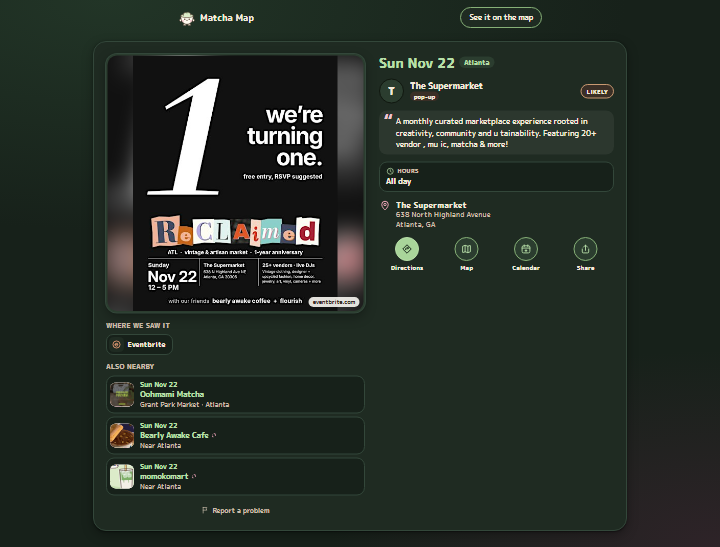 | clean; no overflow, absolute date | none |
| /e/0e589a93f30e/ (drawn art only, approximate) | 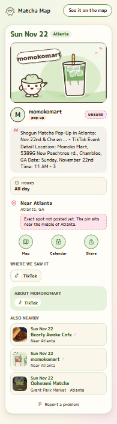 | 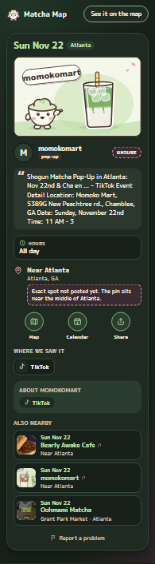 | 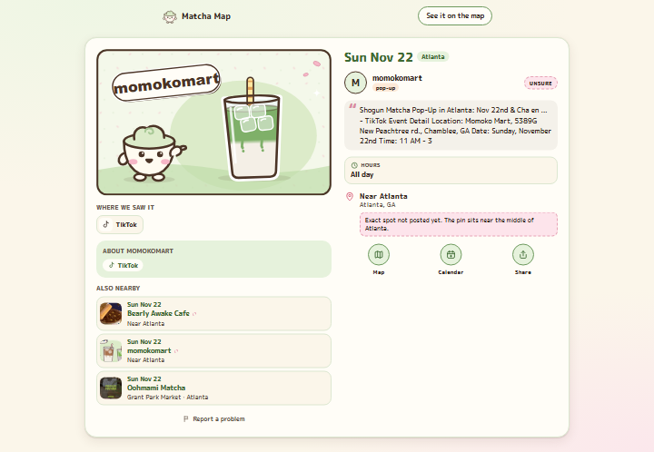 | 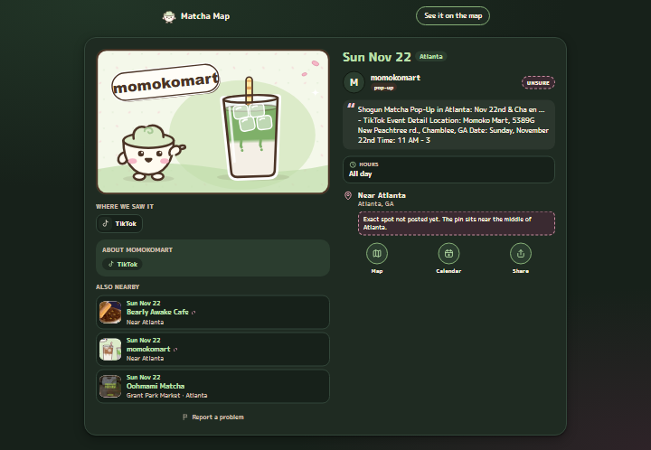 | description and JSON-LD showed raw markdown (`**Event Details**`) | cards.js, gen-event-pages.js |
| /e/070b20cd9a53/ (photo, approximate) | 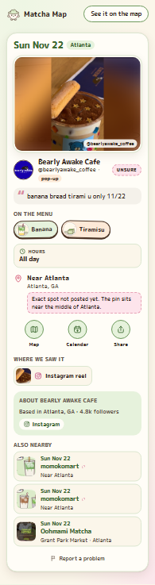 | 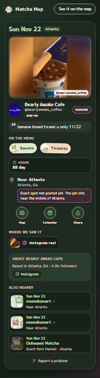 | 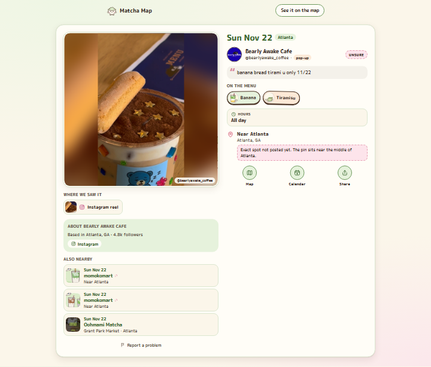 | 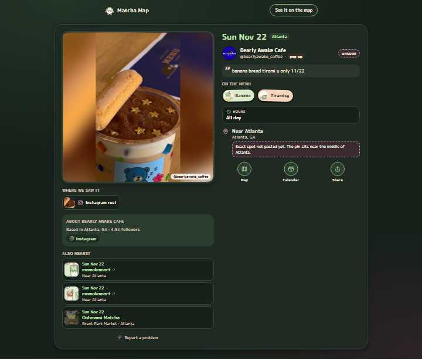 | clean | none |
| /e/c2c10d21c465/ (menu, hours, price) | 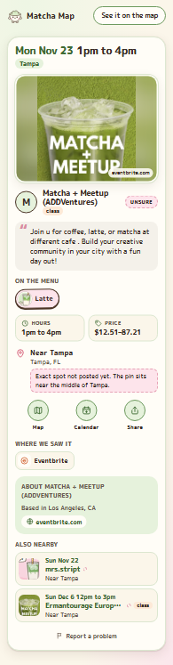 | 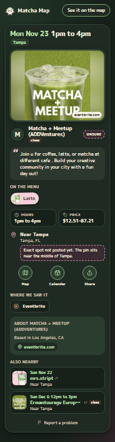 | 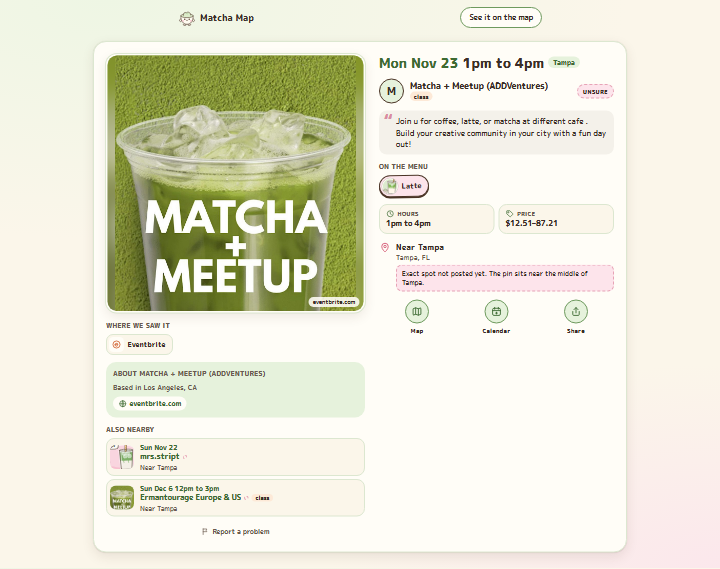 | 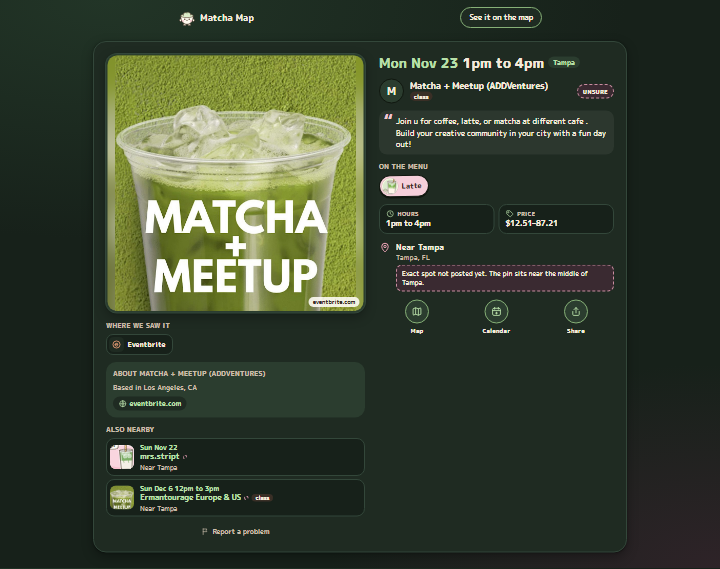 | clean | none |
| /e/1b8f191fb8c9/ (unsure, all day) | 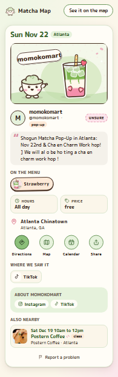 | 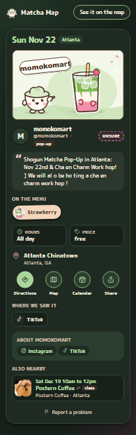 | 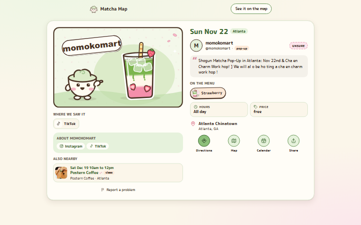 | 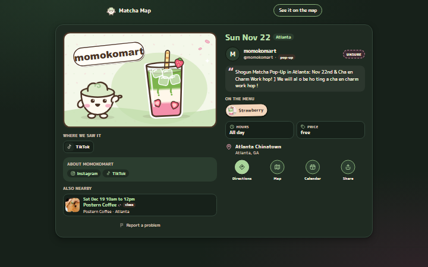 | markdown in description (same fix); four buttons fit at 390 | cards.js |
| /e/7195ba9f3d6b/ (very long venue) | 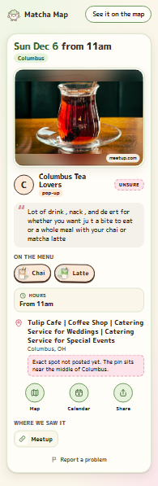 | 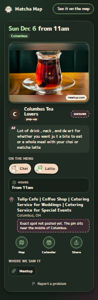 | 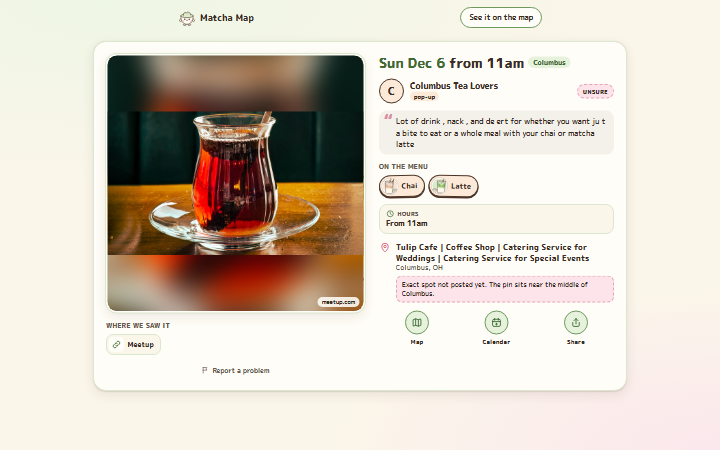 | 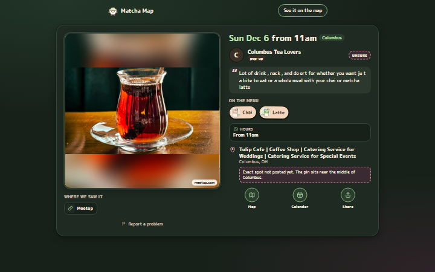 | long venue wraps cleanly | none |
| /cards-demo.html | 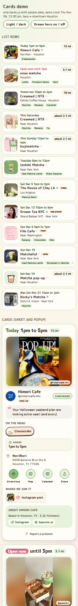 | 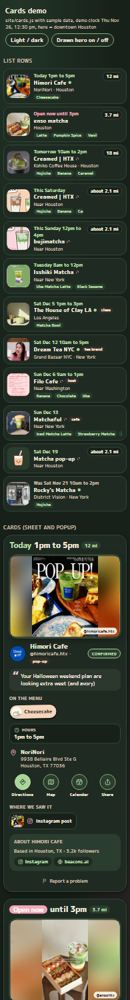 | 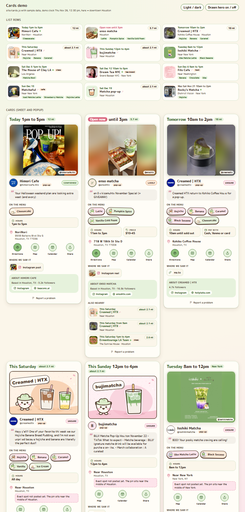 | 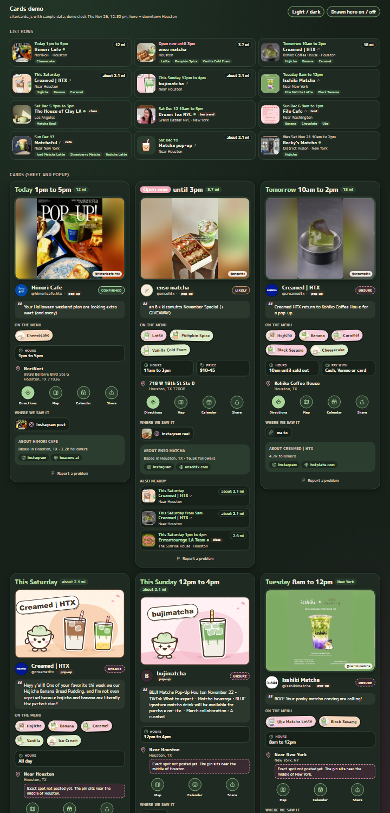 | list-row "class" badge pushed past the row edge instead of the name truncating | cards.js, cards.css |
| /cards-demo.html?phone=390 | 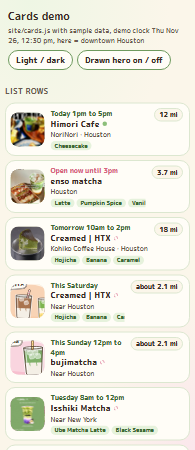 | 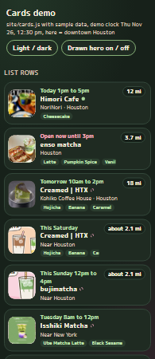 | 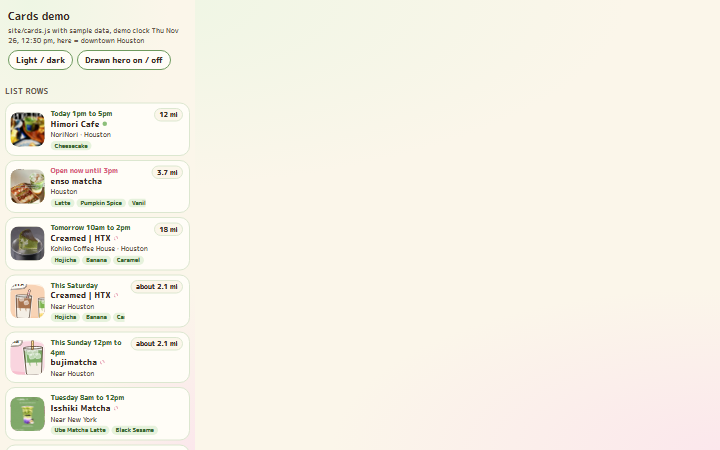 | 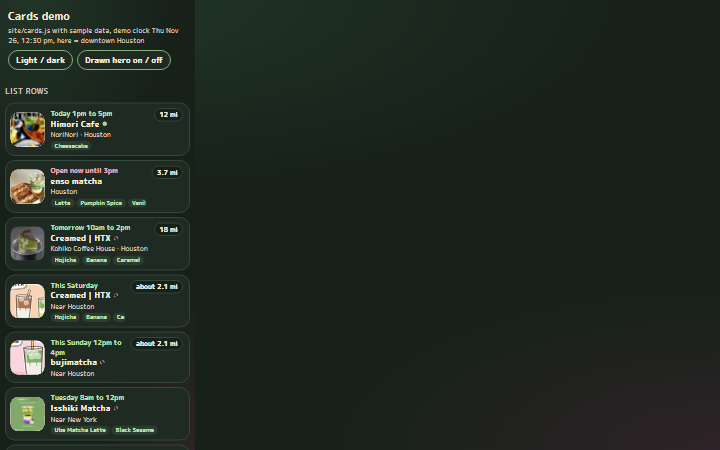 | threw an uncaught "phone frame" error on purpose and held a dead duplicate block | cards-demo.html |

Also checked across all /e/ pages: JSON-LD parses with name, startDate, url; og:image absolute; no "Today", "Tomorrow" or "Open now" in the body; no "undefined"; every img sits in a sized box with object-fit; the static card shows with JavaScript off (it is plain HTML, cards-page.js only wires Share). Share: navigator.share, else clipboard, else (new) execCommand copy, else navigate.

Not fixed: only a favicon 404 on localhost (no favicon.ico; the pages link none).

## Handed off
- og:image on pages whose photo is only a remote Instagram CDN URL (e.g. /e/5c8851ad1635/) uses an expiring signed URL; previews will break when it lapses. Fix in ingest/images.js: download those to site/img/events like the other photos so `image.local` is set.
- tools/gen-pages.js eventLd writes a date-only endDate next to a timed startDate when `all_day` is true with a timed start (/e/834a539a877b/); harmless but inconsistent. Emit the end as a full datetime when start is one.
